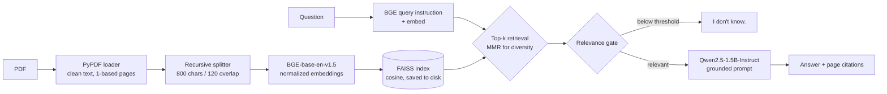

# Local RAG PDF Q&A

[](https://github.com/roshan0774/local-rag-pdf-qa/actions/workflows/ci.yml)
[](https://colab.research.google.com/github/roshan0774/local-rag-pdf-qa/blob/main/notebooks/colab_quickstart.ipynb)

Ask questions about a long PDF and get answers **grounded in the document, with page citations**. Everything runs **locally**: no API keys, and no document text leaves the machine. That makes it suitable for regulated insurance, banking and healthcare content.

The demo document is the **Meridian Mutual FY2026 Annual Operating Report**, a 208-page fictional insurer report built for RAG practice. It's deliberately hard: wide financial tables, 60 near-identical monthly regional reports, state rate cards, and thousands of rows of agents, policies and claims.

## The document

[`data/meridian_mutual_fy2026_full_report.pdf`](data/meridian_mutual_fy2026_full_report.pdf) (208 pages, fictional)

| Pages | Part | What makes it hard for retrieval |
|---|---|---|
| 2 | Company fact sheet and regional structure | Key-value table without borders |
| 3 | Consolidated financial results | Quarterly grid, two-row headers, a 14-column monthly income statement |
| 4–27 | 60 monthly regional operating reports (5 regions × 12 months) | **Near-duplicates**: every report has the same wording, so the retriever must match region *and* month |
| 28–37 | Product rate cards by state | Repeated tables; some states share identical rates |
| 38–57 | Agent directory | Exact-ID lookup (`AGT-5007`) in dense tables |
| 58–111 | Policy register | Exact-ID lookup (`CP-700028`) |
| 112–206 | Claims log | Exact-ID lookup plus free-text adjuster notes |
| 207 | Reinsurance program | Merged column headers |
| 208 | Glossary | Definitions |

## How it works



| Stage | Choice | Why |
|---|---|---|
| Loading | `PyPDFLoader`, hyphenation and whitespace cleanup | Keeps page numbers (1-based, matching the report's footer) for citations |
| Chunking | `RecursiveCharacterTextSplitter`, 800 / 120 | Splits on paragraphs, then sentences, so facts stay together; 1,111 chunks for this report |
| Embeddings | `BAAI/bge-base-en-v1.5`, normalized, query instruction | Strong open retrieval model; the instruction prefix improves BGE query recall |
| Vector store | FAISS inner product (cosine), persisted with a manifest | Build the index once, query many times; the manifest catches embedding-model mismatches |
| Retrieval | MMR (`fetch_k=20`, `k=4`) | Stops near-duplicate monthly reports from filling the whole context window |
| Guardrails | Relevance gate + "context only, cite pages, else *I don't know.*" prompt | Unanswerable questions (CTO, stock price, London office) should be refused, not made up |
| Generation | `Qwen/Qwen2.5-1.5B-Instruct`, greedy decoding | Runs on CPU or a free Colab T4; deterministic output |

## Evaluation

[`eval/golden_meridian.jsonl`](eval/golden_meridian.jsonl) holds **26 questions written from the report itself**. Each has its source page and expected answer, and a script confirmed every answer appears on its page. There are 23 answerable questions across 9 question types, plus 3 the report can't answer:

| Type | Example question | Answer (page) |
|---|---|---|
| Fact sheet | Who is Meridian Mutual's Chief Financial Officer? | Marcus Oyelaran (p. 2) |
| Financial table | What was the combined ratio in 2026? | 89.2% (p. 3) |
| Monthly report | What was the Net Promoter Score for the Northeast region in January 2026? | 48 (p. 4) |
| Rate card | What is the monthly premium for Basic personal auto in South Carolina? | $99 (p. 28) |
| Agent directory | Which agent has ID AGT-5007 and in which state? | Rahul Brown, NV (p. 38) |
| Policy register | What is the annual premium on policy CP-700028? | $38,933 (p. 58) |
| Claims log | Why was claim CLM-26-11679 denied? | Loss predates policy effective date (p. 112) |
| Reinsurance | What is the retention on Cat XL Layer 2? | $150M (p. 207) |
| Glossary | How does the report define rate on line? | Premium ÷ layer limit (p. 208) |
| Unanswerable | Who is Meridian Mutual's Chief Technology Officer? | *I don't know.* |

Metrics: `hit@k` (the right page is retrieved), `mrr`, `answer_match` (the answer contains the expected fact), `citation_ok` (it cites the right page) and `idk_correct` (unanswerable questions are refused).

### Baseline result

CI runs the retrieval eval on every push using the offline `hash` embedder, a bag-of-words vectorizer that needs no model download. It sets the floor that neural embeddings have to beat:

| Question type | hit@4 (hash baseline) |
|---|---|
| Policy register | 2 / 2 |
| Agent directory | 1 / 1 |
| Glossary | 1 / 1 |
| Rate card | 1 / 2 |
| Monthly report | 2 / 5 |
| Reinsurance | 1 / 3 |
| Fact sheet | 1 / 4 |
| Financial table | 0 / 3 |
| Claims log | 0 / 2 |
| **Overall** | **hit@4 = 0.39, MRR = 0.37** |

What the baseline shows: PyPDF extracts table cells one per line, so table-heavy pages (financials, claims) lose their row structure. Paraphrased questions ("net income for fiscal 2026") then don't match the table text by keywords. The [Colab notebook](notebooks/colab_quickstart.ipynb) runs the full BGE + Qwen stack, including answer, citation and refusal metrics.

## Quick start

```bash
git clone https://github.com/roshan0774/local-rag-pdf-qa.git
cd local-rag-pdf-qa
python -m venv .venv && source .venv/bin/activate
pip install -r requirements.txt            # installs the package with torch + transformers

rag-pdf-qa ingest data/meridian_mutual_fy2026_full_report.pdf
rag-pdf-qa ask "What was the combined ratio in 2026?"
rag-pdf-qa chat                            # interactive loop
rag-pdf-qa eval eval/golden_meridian.jsonl --with-llm --out eval/results.json
```

On first run the models (about 0.4 GB for embeddings and 3 GB for the LLM) download from Hugging Face. A GPU is used automatically if available (CUDA or Apple MPS). To use your own documents, pass any PDF or folder of PDFs to `ingest`.

```bash
rag-pdf-qa ask "..." --retrieval-only      # inspect retrieved chunks and the top cosine score; no LLM
rag-pdf-qa ask "..." --json                # machine-readable answer + sources
```

## Configuration

Every setting in [`config.py`](src/rag_pdf_qa/config.py) can be overridden with an environment variable named `RAG_<SETTING>`:

| Variable | Default | Notes |
|---|---|---|
| `RAG_EMBEDDING_MODEL` | `BAAI/bge-base-en-v1.5` | `BAAI/bge-small-en-v1.5` for a lighter model |
| `RAG_LLM_MODEL` | `Qwen/Qwen2.5-1.5B-Instruct` | Any Hugging Face chat model, e.g. `Qwen/Qwen2.5-3B-Instruct` |
| `RAG_CHUNK_SIZE` / `RAG_CHUNK_OVERLAP` | `800` / `120` | Re-ingest after changing |
| `RAG_TOP_K` / `RAG_SEARCH_TYPE` | `4` / `mmr` | `similarity` for plain top-k |
| `RAG_MIN_RELEVANCE` | `0.0` (off) | Cosine floor for the "I don't know" gate; tune with `eval` |
| `RAG_INDEX_DIR` | `index` | |
| `RAG_DEVICE` | `auto` | `cpu`, `cuda`, `mps` |

## Project layout

```
src/rag_pdf_qa/
  config.py       settings + env overrides, device detection
  ingest.py       load -> clean -> chunk -> embed -> FAISS (+ manifest)
  embeddings.py   BGE with query instruction; offline hashing embedder for CI
  llm.py          local Hugging Face chat model (swappable: any callable messages -> str)
  pipeline.py     retrieval, relevance gate, grounded prompt, answer + sources
  evaluate.py     golden-set metrics
  cli.py          ingest | ask | chat | eval
data/meridian_mutual_fy2026_full_report.pdf   208-page demo report (fictional)
eval/golden_meridian.jsonl                    26-question golden set for the report
eval/golden_sample.jsonl + scripts/make_sample_pdf.py   small 8-page fixture (fictional "Bluestone Mutual") used by unit tests
tests/                                        offline pytest suite (fake LLM, hashing embeddings)
notebooks/colab_quickstart.ipynb
```

## Tests

```bash
pip install -r requirements-dev.txt
pytest -q
```

The suite runs fully offline in about a second. It covers page numbering, chunking, index round-trips, embedding-mismatch detection, retrieval, prompt grounding, the relevance gate, MMR, golden-set scoring and the CLI.

## Roadmap

These are driven by where the baseline fails:

- **Hybrid retrieval (BM25 + dense)** for exact IDs like `CLM-26-11679` and `AGT-5007`
- **Table-aware parsing** (e.g. `pdfplumber` / Docling) so table rows stay intact as chunks
- **Metadata filters** for region and month on the 60 monthly reports
- Cross-encoder reranking (`BAAI/bge-reranker-base`)
- RAGAS faithfulness and answer-relevancy scoring
- FastAPI endpoint and a small Streamlit UI

## Note on the data

*Meridian Mutual Insurance Group* is fictional. The report was generated for RAG practice, and any resemblance to real companies or people is coincidental.

## License

MIT
