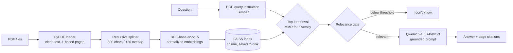

# Local RAG PDF Q&A

[](https://github.com/roshan0774/local-rag-pdf-qa/actions/workflows/ci.yml)
[](https://colab.research.google.com/github/roshan0774/local-rag-pdf-qa/blob/main/notebooks/colab_quickstart.ipynb)

Ask questions about a PDF (an annual report, a policy document, a claims manual) and get answers **grounded in the document with page citations**. Everything runs **locally**. No API keys, and no document text leaves the machine. That makes it suitable for regulated financial-services and healthcare content.

Example session (the wording of answers varies by model):

```
$ rag-pdf-qa ask "What was the combined ratio in FY2026?"

Answer:
The combined ratio improved to 94.2% in FY2026, down from 99.1% the prior year [p. 3].

Sources:
  - meridian_mutual_fy2026_report.pdf p. 3: Financial Highlights  Net income for FY2026 was $214 million...
```

## How it works



| Stage | Choice | Why |
|---|---|---|
| Loading | `PyPDFLoader`, hyphenation and whitespace cleanup | Page numbers are kept (1-based) for citations |
| Chunking | `RecursiveCharacterTextSplitter`, 800 / 120 | Splits on paragraphs, then sentences, so facts stay together |
| Embeddings | `BAAI/bge-base-en-v1.5`, normalized, query instruction | Strong open retrieval model; the instruction prefix improves BGE query recall |
| Vector store | FAISS inner product (cosine), persisted with a manifest | Build the index once, query many times; the manifest catches embedding-model mismatches |
| Retrieval | MMR (`fetch_k=20`, `k=4`) | Avoids four near-duplicate chunks taking up the context window |
| Guardrails | Relevance gate + "context only, cite pages, else *I don't know.*" prompt | Cuts hallucination; unanswerable questions are refused |
| Generation | `Qwen/Qwen2.5-1.5B-Instruct`, greedy decoding | Runs on CPU or a free Colab T4; deterministic output |
| Evaluation | Golden JSONL set: hit@k, MRR, answer match, citation accuracy, IDK accuracy | Retrieval quality is measured, not assumed |

## Quick start

```bash
git clone https://github.com/roshan0774/local-rag-pdf-qa.git
cd local-rag-pdf-qa
python -m venv .venv && source .venv/bin/activate
pip install -r requirements.txt            # installs the package with torch + transformers

python scripts/make_sample_pdf.py          # sample (fictional) insurer annual report
rag-pdf-qa ingest data/sample/meridian_mutual_fy2026_report.pdf
rag-pdf-qa ask "How many claims were processed in FY2026?"
rag-pdf-qa chat                            # interactive loop
```

To use your own documents, pass any PDF or a folder of PDFs to `ingest`. On first run the models (about 0.4 GB for embeddings and 3 GB for the LLM) are downloaded from Hugging Face. A GPU is used automatically if one is available (CUDA or Apple MPS).

Other useful commands:

```bash
rag-pdf-qa ask "..." --retrieval-only      # inspect retrieved chunks and the top cosine score; no LLM
rag-pdf-qa ask "..." --json                # machine-readable answer + sources
rag-pdf-qa eval eval/golden.jsonl -k 4                 # retrieval metrics only (fast)
rag-pdf-qa eval eval/golden.jsonl --with-llm --out eval/results.json   # full answer scoring
```

## Configuration

Every setting in [`config.py`](src/rag_pdf_qa/config.py) can be overridden with an environment variable named `RAG_<SETTING>`:

| Variable | Default | Notes |
|---|---|---|
| `RAG_EMBEDDING_MODEL` | `BAAI/bge-base-en-v1.5` | Use `BAAI/bge-small-en-v1.5` for a lighter model |
| `RAG_LLM_MODEL` | `Qwen/Qwen2.5-1.5B-Instruct` | Any Hugging Face chat model, e.g. `Qwen/Qwen2.5-3B-Instruct` |
| `RAG_CHUNK_SIZE` / `RAG_CHUNK_OVERLAP` | `800` / `120` | Re-ingest after changing |
| `RAG_TOP_K` / `RAG_SEARCH_TYPE` | `4` / `mmr` | `similarity` for plain top-k |
| `RAG_MIN_RELEVANCE` | `0.0` (off) | Cosine floor for the "I don't know" gate; tune with `eval` |
| `RAG_INDEX_DIR` | `index` | |
| `RAG_DEVICE` | `auto` | `cpu`, `cuda`, `mps` |

## Evaluation

[`eval/golden.jsonl`](eval/golden.jsonl) has 14 questions about the sample report: 12 answerable, each with expected pages and expected answer strings, and 2 unanswerable questions that should get "I don't know."

| Metric | What it measures |
|---|---|
| `hit@k` | An expected page appears in the top-k retrieved chunks |
| `mrr` | How high the first correct chunk ranks |
| `answer_match` | The answer contains every expected fact (e.g. `94.2%`) |
| `citation_ok` | The answer cites at least one correct page |
| `idk_correct` | Unanswerable questions are refused instead of made up |

CI runs the retrieval eval on every push using the offline `hash` embedder, a deterministic bag-of-words vectorizer that needs no model download. With that crude baseline the sample set scores **hit@4 = 1.00, MRR = 0.94**. Run the Colab notebook to score the full BGE + Qwen stack, including answer and citation metrics.

## Project layout

```
src/rag_pdf_qa/
  config.py       settings + env overrides, device detection
  ingest.py       load -> clean -> chunk -> embed -> FAISS (+ manifest)
  embeddings.py   BGE with query instruction; offline hashing embedder for CI
  llm.py          local Hugging Face chat model (swappable: any callable messages -> str)
  pipeline.py     retrieval, relevance gate, grounded prompt, answer + sources
  evaluate.py     golden-set metrics
  cli.py          ingest | ask | chat | eval
scripts/make_sample_pdf.py   builds the fictional sample report
eval/golden.jsonl            golden Q&A set
tests/                       offline pytest suite (fake LLM, hashing embeddings)
notebooks/colab_quickstart.ipynb
```

## Tests

```bash
pip install -r requirements-dev.txt
pytest -q
```

The suite runs fully offline in about a second. It covers page numbering, chunking, index round-trips, embedding-mismatch detection, retrieval accuracy, prompt grounding, the relevance gate, MMR, the golden-set hit rate and the CLI.

## Roadmap

- Hybrid retrieval (BM25 + dense) with a cross-encoder reranker (`BAAI/bge-reranker-base`)
- Table-aware PDF parsing for financial statements
- RAGAS faithfulness and answer-relevancy scoring
- FastAPI endpoint and a small Streamlit UI
- Optional Ollama / OpenAI-compatible backend for larger models

## Note on the sample data

*Meridian Mutual* is a fictional company. The sample report and every figure in it were invented for this demo.

## License

MIT
